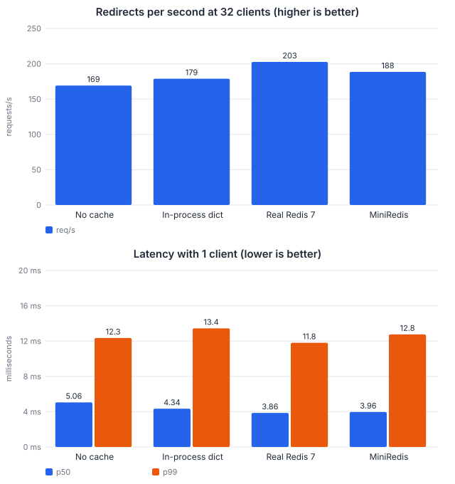
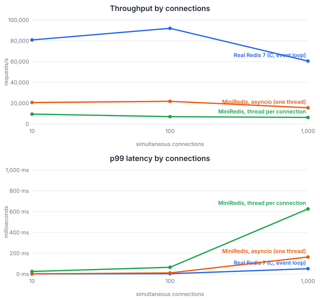
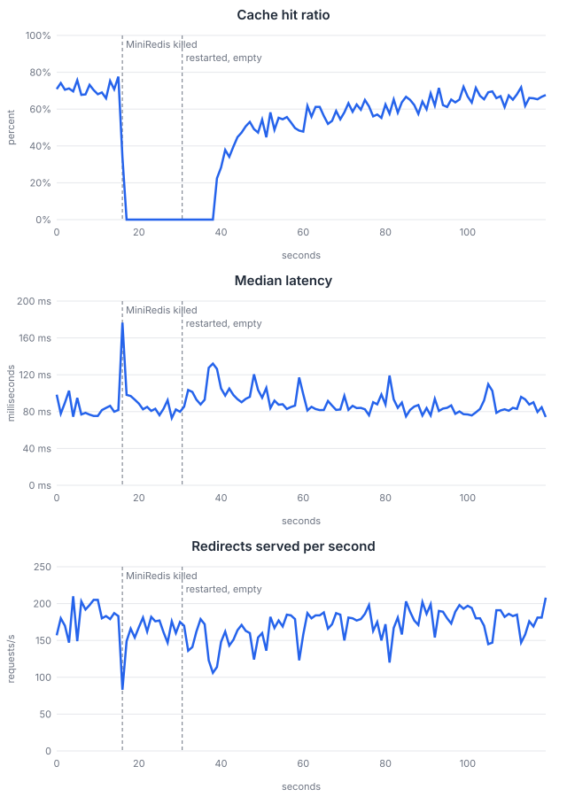

# ShortLink + MiniRedis

A URL shortener backend (FastAPI + PostgreSQL) whose cache, rate limiter and click queue run on a Redis-compatible server written from scratch in Python (MiniRedis).

[](https://github.com/vamsi2702/shortlink-redis/actions/workflows/ci.yml)

See [PLAN.md](PLAN.md) for the plan and [docs/DIAGRAMS.md](docs/DIAGRAMS.md) for diagrams.

**Status:** Phases 1 to 5 are complete: the backend, MiniRedis (protocol, commands, expiry, lists, hashes, Pub/Sub), the API using MiniRedis for caching, rate limiting and a click queue (with a click worker and `/metrics`), and the measurements in [Benchmarks](#benchmarks). Phase 6 (deployment) is optional and not started.

## Run everything

```powershell
docker compose up -d --build   # PostgreSQL, MiniRedis, the API, the click worker (tables are created for you)
```

The API is then at http://localhost:8000 (interactive docs at `/docs`, numbers at `/metrics`).
`docker compose down` stops it; the database keeps its data, MiniRedis does not (it is memory only).

```
browser ──► API ──► MiniRedis   cache (GET/SET), rate limit (SET NX + INCR), click queue (LPUSH)
             │          ▲
             ▼          │ RPOP in batches
         PostgreSQL ◄── click worker
```

## Setup for development

Run only the database in Docker and the rest on your machine:

```powershell
python -m venv .venv
.venv\Scripts\Activate.ps1
pip install -e ".[dev]"
docker compose up -d postgres   # starts PostgreSQL
alembic upgrade head            # creates the tables
uvicorn api.main:app --reload   # http://127.0.0.1:8000  (interactive docs at /docs)
```

That uses the API's own in-process cache, and clicks are not recorded. To use MiniRedis too, start it
and the worker in two more terminals and point the API at it:

```powershell
python -m miniredis.server                     # 127.0.0.1:6380
$env:MINIREDIS_URL = "redis://127.0.0.1:6380"  # set this before starting uvicorn and the worker
python -m api.worker                           # saves queued clicks to PostgreSQL
```

Run the tests (PostgreSQL must be running; `docker compose up -d redis` also starts a real Redis,
which the comparison tests check MiniRedis against, and they are skipped without it):

```powershell
pytest                                       # all tests, about a minute
pytest --cov=api --cov=miniredis --cov-report=term-missing   # with coverage
ruff check .                                 # lint
mypy api miniredis bench                     # types
```

[GitHub Actions](.github/workflows/ci.yml) runs the same steps (with PostgreSQL and Redis as
service containers, and a coverage floor of 90%) on every push. Coverage is 97% overall; the core
modules are `commands.py` 99%, `resp.py` 98%, `store.py` 97% and `server.py` 86%.

## MiniRedis

A Redis-compatible server written from scratch (see [PLAN.md](PLAN.md), Phases 2 and 3).

```powershell
python -m miniredis.server            # listens on 127.0.0.1:6380
```

It speaks RESP2, so `redis-cli` and `redis-py` work. With `redis-py`, **use `protocol=2`**: its
default asks for RESP3 first, and MiniRedis answers `NOPROTO unsupported protocol version`.

```python
import redis
r = redis.Redis(port=6380, protocol=2)
r.set("name", "vamsi")
r.get("name")          # b'vamsi'
r.incr("hits")         # 1
```

| Area | Commands |
|---|---|
| Strings | `SET` (with `EX PX EXAT PXAT NX XX KEEPTTL`), `GET`, `DEL`, `EXISTS`, `INCR`, `INCRBY` |
| Expiry | `EXPIRE PEXPIRE EXPIREAT PEXPIREAT` (with `NX XX GT LT`), `TTL`, `PTTL`, `PERSIST` |
| Lists | `LPUSH`, `RPOP` (with a count), `LLEN`, `LRANGE` |
| Hashes | `HSET`, `HGET`, `HGETALL` |
| Pub/Sub | `SUBSCRIBE`, `UNSUBSCRIBE`, `PUBLISH` |
| Server | `INFO`, `TYPE`, `PING`, `ECHO`, `CLIENT`, `HELLO 2`, `COMMAND`, `QUIT` |

**Memory only.** MiniRedis keeps all its data in memory, like a cache: when the server stops, the
data is gone. Expired keys are removed both when they are touched and by a background cleaner.
(An append-only-file persistence feature was built and then removed again; it is in the git
history before the commit "Remove append-only file persistence" if it is ever wanted back.)

Replies are checked against real Redis by the tests in
`miniredis/tests/test_compat_real_redis.py` and `test_pubsub.py` (run `docker compose up -d redis`
to enable them).

Not implemented: persistence to disk, `SET ... GET`, RESP3 (`HELLO 3`), pattern subscriptions,
transactions, scripting, replication, `FLUSHALL`, eviction when memory is full.

## API

| Method and path | Auth | What it does |
|---|---|---|
| `GET /` | none | A basic web page: shorten links, sign in, manage your links |
| `GET /health` | none | Liveness check |
| `POST /auth/register` | none | Create an account (`email`, `password` of 8-72 bytes) |
| `POST /auth/login` | none | Returns a bearer token (valid 60 minutes) |
| `GET /auth/me` | token | The logged-in user |
| `POST /shorten` | optional | Body `{"url": "..."}`. With a token, the link belongs to you |
| `GET /links` | token | Your links, newest first (`limit`, `offset`) |
| `PATCH /links/{code}` | token | Change where your link points |
| `DELETE /links/{code}` | token | Delete your link and its clicks |
| `GET /{code}` | none | 302 redirect to the long URL, or 404 |
| `GET /metrics` | none | Request counts, cache hits and misses, latency (Prometheus text format). Keep it off the public internet |

Redirects, `POST /shorten` and `/auth/register` + `/auth/login` are rate limited: past 100 requests
a minute from one client (the signed-in user, or else the IP address), they answer `429` with a
`Retry-After` header. Each of the three groups has its own count.

Send the token as `Authorization: Bearer <token>`. In `/docs`, use the **Authorize** button and paste the token.

## How it works

- **Short codes:** 6 random base62 characters (about 56 billion combinations). Collisions are settled by the database's unique constraint, with a retry.
- **URL validation:** only `http`/`https`; no credentials in the URL; no localhost, private or reserved addresses. No DNS lookup is done, so a public name that points to a private address is not caught.
- **Caching:** redirects use cache-aside. Lookups hit the cache first (5 minute TTL), then Postgres. Unknown codes are cached for 30 seconds. Creating, editing and deleting a link clears its entry.
- **Auth:** passwords are hashed with bcrypt; login returns a signed JWT. Other people's links return 404, not 403, so their existence is not revealed.
- **Redirect status:** 302, not 301, so browsers keep asking the server and clicks can be counted.
- **Rate limiting:** a fixed window per client: `SET key 0 NX EX 60`, then `INCR`. Past the limit the answer is 429. If MiniRedis is down the limiter lets requests through ("fails open") instead of taking the site down.
- **Click queue:** a redirect only does one `LPUSH clicks "<code> <time>"` into MiniRedis. The worker takes up to 100 events at a time (`RPOP clicks 100`) and writes them to the `clicks` table with one INSERT. If the database write fails, the events are put back.
- **When MiniRedis is down:** redirects fall back to Postgres, and after one failure the API stops trying MiniRedis for 5 seconds so the dead server does not slow every request. Clicks queued at that moment, and clicks still waiting in a MiniRedis that restarts, are lost (it is memory only).
- **Metrics:** `/metrics` counts requests by route *template* (`/{code}`, not each real code), and records cache hits and misses, 429s, queued and dropped clicks, and MiniRedis failures. The numbers are per process and reset on restart.

## Benchmarks

Measured on one laptop (Intel i7-1260P, 16 GB RAM, Windows 11) with Docker Desktop, which runs a
Linux VM with 16 CPUs and 6.8 GB. Everything runs in containers: Python 3.12.15, PostgreSQL 16.13,
Redis 7.4.11. CPU limits: API 2, Redis 1, MiniRedis 1, click worker 1, load generator 4. The load
generator runs in a container on the same Docker network as the API, so the numbers do not include
Windows' slow forwarding of ports into Docker. The raw results are in [bench/results/](bench/results/).

**How the tests are kept fair**

- **The same data:** 100,000 links and 100 users, generated from a fixed seed (`bench.seed`), and
  reloaded before every setup. Reads are 95% redirects and 5% link creation; the redirects follow
  a Zipf distribution (the hottest 1% of links get 62% of the traffic), as real traffic does.
- **The same start:** both caches are recreated empty for every setup. A **cold run** (nothing
  cached) comes first, then a warm-up of 30,000 requests, then **three measured runs of 15
  seconds**. The tables show the **median** of the three.
- **Fresh requests each run:** every run draws new requests from the same distribution. (My first
  attempt reused one seed, so later runs replayed the first run's requests, found them all cached
  and reported a hit ratio of 100%. It looked fine until I read the per-run numbers.)
- **A load generator that is not the bottleneck:** the first one, built on `httpx`, topped out at
  about 125 requests/s against a server that a plain asyncio client drove at about 500. It was
  measuring itself. The current one speaks HTTP directly (`bench/loadtest.py`) and uses under 10%
  of a CPU.
- **Only the cache changes** between setups: the rate limiter and the click queue are switched
  off for these runs, so that "no cache" is not also skipping Redis calls the others make.

### 1. Redirects through the API

| Setup | Hit ratio | 1 client: p50 / p99 ms | 32 clients: req/s | 32 clients: p50 / p99 ms |
|---|---:|---|---:|---|
| No cache (every redirect asks Postgres) | 0% | 5.06 / 12.35 | 169 | 182 / 336 |
| In-process dict (the Phase 1 cache) | 70% | 4.34 / 13.44 | 179 | 162 / 351 |
| Real Redis 7 | 78% | 3.86 / 11.80 | 203 | 148 / 310 |
| MiniRedis | 78% | 3.96 / 12.75 | 188 | 157 / 334 |



What this shows, and what it does not:

- **A cache helps, but modestly, because the API is the bottleneck.** One Python process spends
  about 4 to 5 ms of CPU per redirect (FastAPI and SQLAlchemy) and saturates at roughly 200
  requests/s, using about 1.1 cores. A cache saves only about 1.2 ms per redirect (5.06 ms
  against 3.86 ms): the net gain of a Redis lookup over a Postgres lookup on an indexed
  100,000-row table.
- With a cache the median redirect took **22 to 24% less time** (5.06 ms down to 3.86 ms with Redis
  and 3.96 ms with MiniRedis), and throughput at 32 clients rose by **11 to 20%**.
- **p99 did not improve measurably.** The p99 values at one client (11.8 to 13.4 ms) differ by less
  than the spread between repeated runs, so I make no claim that the cache cuts tail latency here.
- **MiniRedis and real Redis cannot be told apart at this level.** Their differences are smaller
  than the run-to-run spread (at 32 clients MiniRedis managed 186, 188 and 207 req/s across three
  runs, Redis 191, 203 and 208). The cache server is not what limits the API.
- The in-process dict has a lower hit ratio because it holds at most 10,000 entries and evicts the
  oldest, while Redis and MiniRedis keep all 100,000.
- The hit ratios (70 to 78%) belong to a warm-up of 30,000 requests spread over 100,000 links.
  A Zipf workload keeps improving slowly as the cache fills; no setup was warmed for longer.

**The whole system, with the rate limiter and the click queue on.** Section 1 isolated the cache.
The real API also makes a rate-limit check (two commands) and queues a click (one more) on every
redirect, so a redirect makes four round trips to the cache server, and the click worker writes
the clicks to Postgres at the same time. Same method, same data:

| Setup | 1 client: p50 / p99 ms | 32 clients: req/s | 32 clients: p50 / p99 ms |
|---|---|---:|---|
| Real Redis, rate limit and clicks on | 4.58 / 16.90 | 180 | 158 / 378 |
| MiniRedis, rate limit and clicks on | 5.05 / 20.94 | 172 | 181 / 387 |

Here MiniRedis is **visibly slower**: about 0.5 ms (10%) more per redirect at one client and 4% less
throughput at 32. Each of the four round trips pays MiniRedis's higher per-command cost
(section 2), where a cache-only redirect pays it once, below the noise. At 32 clients the gap
(172 against 180 req/s) is still within the spread of the three runs (148 to 174 for MiniRedis,
174 to 185 for Redis), so I would not call that part a difference. There were no failed requests.

### 2. How fast is the cache server itself?

`redis-benchmark` (a C program run inside the Redis container, so it cannot be the bottleneck)
sending `GET` and `SET` to each server, every server limited to one CPU. Median of three runs.

| Server | Connections | GET req/s | GET p50 / p99 ms | CPU seconds per 100,000 commands |
|---|---:|---:|---|---:|
| Real Redis 7 | 10 | 80,841 | 0.05 / 0.34 | 1.31 |
| MiniRedis (asyncio) | 10 | 20,691 | 0.45 / 1.10 | 4.79 |
| MiniRedis (thread per connection) | 10 | 9,542 | 0.82 / 24.5 | 13.45 |

MiniRedis, written in Python, is **about 4 times slower than real Redis** and uses about 3.7 times
the CPU for each command. Section 1 shows that the API cannot tell the difference, because the API
spends milliseconds per request and the cache only microseconds.

### 3. asyncio or a thread for every connection?

The asyncio server serves all clients from one thread, and a command never waits, so no command
can be interrupted: that is what makes every command atomic without locks. The alternative is a
thread per connection with one lock around the store ([miniredis/threaded_server.py](miniredis/threaded_server.py)).
It runs the same commands and gives byte-identical answers (a test checks this).



| Connections | Real Redis GET/s | asyncio GET/s | threaded GET/s | asyncio p99 ms | threaded p99 ms |
|---:|---:|---:|---:|---:|---:|
| 10 | 80,841 | 20,691 | 9,542 | 1.1 | 24.5 |
| 100 | 91,996 | 21,815 | 7,046 | 10.7 | 64.4 |
| 1,000 | 60,496 | 15,632 | 6,293 | 164 | 626 |

- **asyncio is 2.2 to 3.1 times faster and uses about a third of the CPU per command.** At 1,000
  connections it uses +6 MiB of memory, the threaded server +25 MiB, and real Redis +12 MiB.
- Threads are slower here because of how CPython works: the global interpreter lock lets only one
  thread run at a time, so threads add switching and lock hand-offs without adding any parallelism.
  This does not say that threads are always worse; it says they cannot help in this language.
- Everything slows down at 1,000 connections, real Redis included (92,000 down to 60,000 GET/s).
- I did not test 5,000 connections. The plan mentioned it, but 1,000 already separates the designs.

### 4. What happens when MiniRedis is killed under load

16 clients, 120 seconds, about 190 requests/s. After the cache is warm, MiniRedis is **killed with
SIGKILL** (a crash, not a tidy shutdown) at 15 seconds and started again, empty, 15 seconds later.
Median of three repeats.



| Measured | Result |
|---|---|
| Failed requests | **0** of about 20,400 in every repeat |
| Median latency before / during / after | 80 / 83 / 80 ms: no slower while MiniRedis is down |
| Cache hit ratio before / during / after | 71% / 0% / 67% (over the last 20 seconds) |
| Time for the hit ratio to get back to 50% / 75% / 90% of normal | about 9 / 21 / 53 seconds |
| Clicks lost | 15 to 19% of the clicks served in the test |

- **The API stays up.** Redirects fall back to Postgres, the rate limiter lets requests through,
  and nothing errors. Median latency does not rise while the cache is down. (My explanation, not
  separately measured: skipping the four MiniRedis round trips a redirect normally makes saves
  about as much as the Postgres lookup costs.)
- **The cache warms back up quickly at first and slowly at the end.** It is not used at all for
  4.5 to 8.4 seconds after MiniRedis returns (the circuit breaker waits 5 seconds between checks,
  and a check can itself take a few seconds). Half of the normal hit ratio is back about 9 seconds
  after the restart, three quarters after about 21 seconds, and the last tenth takes close to a
  minute.
- **Clicks are lost, by design.** MiniRedis keeps nothing on disk. Almost all of the lost clicks
  (2,900 to 3,500 per repeat) were redirects served **while MiniRedis was down**, roughly the
  request rate times the length of the outage. Only 21 to 198 clicks, up to about a second of
  traffic, were sitting in the queue at the moment of the kill, which is when the worker last
  emptied it. Whether that is acceptable depends on what clicks are used for; the design that
  would avoid it (a log on disk) was built and then removed, see [PLAN.md](PLAN.md).
- **A bug that this test found.** The first run showed p99 latency spiking to **7.5 to 8.1 seconds**
  shortly after the kill, and the throughput chart dropped to zero for a moment. The cause: with the
  MiniRedis container dead, resolving its name takes 3 to 8 seconds, and a socket timeout does not
  cover name resolution (a "0.25 s" connection attempt took 3.4 s). The circuit breaker let every
  request that arrived after its wait try the server at once, so all of them stalled together.
  It now lets exactly one request probe while the others keep skipping, and the worst per-second
  p99 during the outage is **270 to 330 ms**. The earlier results are kept in
  [bench/results/reliability-before-fix.md](bench/results/reliability-before-fix.md) for comparison.

## Limitations and design decisions

- **MiniRedis is memory only.** A restart empties the cache, and click events not yet saved are
  lost (measured above). There is no persistence, no replication and no eviction when memory is full.
- **One machine, one run of each experiment.** The numbers compare setups with each other on this
  laptop; they are not what a server would give. The load generator shares the machine with the
  servers, and Docker Desktop on Windows adds its own overhead.
- **Closed-loop load.** Each simulated client waits for its answer before sending the next
  request, so a slow server is offered less work than real traffic would give it, and the tail
  latencies are a little kinder than in real life. With 32 clients the API is saturated, so
  latency there is mostly queueing (about clients divided by throughput).
- **The click queue has no size limit.** If the worker is down, the list grows without bound
  (MiniRedis has no `LTRIM` to cap it).
- **The rate limiter counts the direct peer's address.** Behind a proxy that is the proxy, so a real
  deployment must pass the client's address through. A fixed window also allows up to twice the
  limit around a window boundary.
- **A redirect makes four round trips to MiniRedis** when the rate limiter and click queue are on
  (two for the limiter, the cache `GET`, the click `LPUSH`). They could be combined; they are not.
- **`/metrics` is public** and should only be reachable by monitoring in a real deployment.
- **A skipped cache `DELETE`** (while MiniRedis is unreachable) can leave an old redirect cached
  for up to its 5-minute TTL once MiniRedis is back with its data intact.
- **Not implemented in MiniRedis:** see the list in the MiniRedis section above.

## Reproducing the benchmarks

Docker must be running. Each command takes the time shown and writes to `bench/results/`.

```powershell
python -m bench.seed                      # the dataset: 100,000 links, 3 seconds
python -m bench.workload --pattern zipf   # see the request stream and how skewed it is
python -m bench.run_benchmarks            # section 1: four setups, about 20 minutes
python -m bench.concurrency               # sections 2 and 3: about 15 minutes
python -m bench.reliability               # section 4: about 15 minutes
python -m bench.render_charts             # redraw the charts from the saved results
```

## Configuration

Environment variables, all optional for local development:

| Variable | Default | Meaning |
|---|---|---|
| `DATABASE_URL` | local Postgres | Where the data lives |
| `BASE_URL` | `http://localhost:8000` | Short links are `BASE_URL/<code>` |
| `JWT_SECRET` | dev-only value | **Must be set in any real deployment** |
| `JWT_EXPIRE_MINUTES`, `BCRYPT_ROUNDS` | 60, 12 | Login token life, password hashing cost |
| `MINIREDIS_URL` | empty | e.g. `redis://localhost:6380`. Empty: use the in-process cache; clicks are not recorded |
| `MINIREDIS_TIMEOUT_SECONDS` | 0.25 | A MiniRedis call slower than this counts as failed |
| `MINIREDIS_RETRY_SECONDS` | 5 | After a failure, wait this long before trying MiniRedis again |
| `CACHE_TTL_SECONDS`, `NOT_FOUND_TTL_SECONDS` | 300, 30 | How long a redirect, or an unknown code, stays cached |
| `RATE_LIMIT_REQUESTS`, `RATE_LIMIT_WINDOW_SECONDS` | 100, 60 | The rate limit |
| `CACHE_ENABLED`, `RATE_LIMIT_ENABLED`, `CLICKS_ENABLED` | true | Switch the redirect cache, the rate limiter, or click recording off. The benchmarks use these to measure one thing at a time. With the cache off the rate limiter is off too, because its counters live in the cache |
| `CLICK_QUEUE_KEY`, `CLICK_BATCH_SIZE`, `CLICK_WORKER_INTERVAL_SECONDS` | clicks, 100, 1 | The click queue and how the worker drains it |
