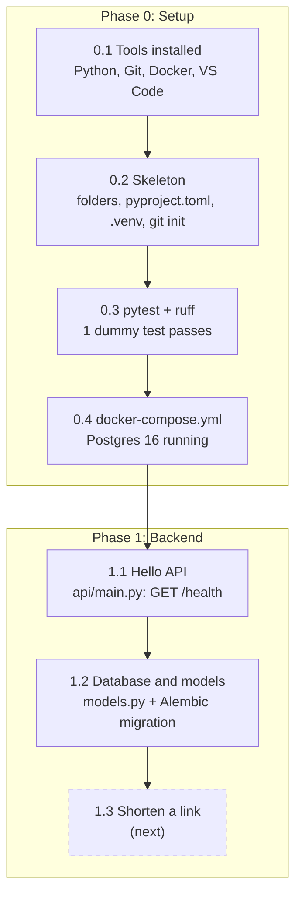
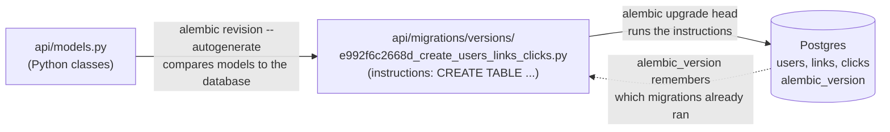
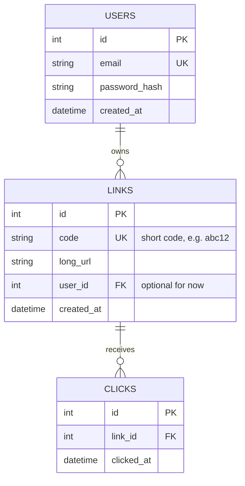

# Diagrams: progress so far, Alembic, and the database

## 1. Work done so far



## 2. How Alembic works



## 3. ER diagram (the database tables)



How to read it: `||--o{` means "one on the left, zero or many on the right". One user owns many links, and one link receives many clicks. PK is the primary key, UK is unique, FK is a foreign key.

## 4. Example rows

**users**

| id | email | password_hash | created_at |
|---|---|---|---|
| 1 | asha@example.com | $2b$12$Xk3... (a hash, never the real password) | 2026-10-08 10:00 |

**links**

| id | code | long_url | user_id | created_at |
|---|---|---|---|---|
| 1 | abc12 | https://example.com/a/very/long/path?x=1&y=2 | 1 | 2026-10-08 10:05 |
| 2 | k9Zq | https://docs.python.org/3/library/asyncio.html | NULL (made without logging in) | 2026-10-08 10:07 |

**clicks**

| id | link_id | clicked_at |
|---|---|---|
| 1 | 1 | 2026-10-08 11:00 |
| 2 | 1 | 2026-10-08 11:02 |
| 3 | 2 | 2026-10-08 11:05 |

Reading the example: Asha owns link `abc12`, which was clicked twice. Link `k9Zq` has no owner and was clicked once.

## 5. Example queries (what the app will do later)

```sql
-- Redirect (step 1.4): find where a code points. Fast because `code` has a unique index.
SELECT long_url FROM links WHERE code = 'abc12';

-- A user's links (step 1.6)
SELECT code, long_url FROM links WHERE user_id = 1;

-- Click count per link (analytics, Phase 4)
SELECT l.code, COUNT(c.id) AS clicks
FROM links l LEFT JOIN clicks c ON c.link_id = l.id
GROUP BY l.code;
```

The same thing in SQLAlchemy, as used in `api/tests/test_models.py`:

```python
link = db.scalar(select(Link).where(Link.code == "abc12"))
print(link.long_url, len(link.clicks))   # https://example.com/... 2
```
